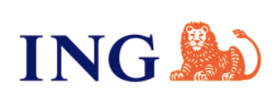

11月3日，澳洲央行（[RBA](https://www.rba.gov.au/monetary-policy/int-rate-decisions/)）宣布将官方现金利率上调0.25个百分点，至**4.85%**，这是今年第五次加息，也是2008年以来的最高水平。这次决议是6比3的多数票通过，另外三位委员主张维持4.60%不变。

自2月开始加息以来，现金利率已经从3.60%累计上调了1.25个百分点。

多家银行的活期存款利率在11月中旬跟着上调，不少账户的奖励利率涨了0.25个百分点。榜首的利率也从10月的6.00%升到了6.30%。

<!--more-->

需要提醒的是，目前排在前几位的账户多数有年龄限制，申请前请先确认自己是否符合。另外，ING Savings Maximiser从12月1日起不再接受新申请。

下面是目前市场上活期存款利率最高的十个账户，排序依据是银行已经公布的利率，包括已经宣布但还没生效的调整：

## Top 1 Virgin Money Boost Saver（开启Lock Saver）

**存款利率**：6.30%（不开启Lock Saver为5.80%）

**封顶金额**：25万澳元

**满足条件**：

1. 开启Lock Saver需要年满18岁，取款要提前32天通知银行
2. 每月从其他银行转入至少1000澳元到Virgin Money Go账户
3. 每月至少5笔已入账的消费、直接扣款或BPAY支付
4. 不满足条件的月份，只有0.05%的基础利率。

**申请链接**：<https://www.virginmoney.com.au/bank-and-save/boost-saver>

---

## Top 2 Newcastle Permanent Smart Saver（25岁以下）

**存款利率**：6.25%

**封顶金额**：5万澳元（超出5万澳元的部分利率明显更低）

**满足条件**：

1. 所有账户持有人在当月第一天必须未满25岁
2. 当月余额有所增加（利息不计）
3. 当月取款不超过2次

**申请链接**：<https://www.newcastlepermanent.com.au/personal/banking-for-under-25s>

---

## Top 3 Westpac Life（Spend&Save）

**存款利率**：6.20%（11月13日起，此前为5.95%）

**封顶金额**：15万澳元（Spend&Save部分适用于15万澳元以内，超出部分为5.50%）

**满足条件**：

1. 18到40岁，名下同时开通Westpac Life和Westpac Choice账户，联名账户不符合
2. 每月账户余额不低于0，至少有一笔存入（利息不计），且月末余额高于上个月
3. 想拿到Spend&Save的0.70%，还需要每月用Choice账户关联的借记卡完成至少20笔已入账的合格消费

只满足第2条而没有满足第3条时，总利率为5.50%。

**申请链接**：<https://www.westpac.com.au/bank-accounts/savings-accounts/spend-save-ntb>

---

## Top 4 ING Savings Maximiser

**存款利率**：6.00%（11月13日起，此前为5.75%）

**封顶金额**：10万澳元

**满足条件**：

1. 每月存入至少1000澳元
2. 每月至少5笔刷卡消费
3. 月末余额高于月初（利息不计）
4. 不满足条件的月份，只有0.01%的基础利率。

12月1日起不再接受新申请，想开户的话时间不多了。或者可以选择ING Savings Booster，目前有$100新户奖励。详见下文。

**申请链接**：<https://www.ing.com.au/savings/savings-maximiser.html>

---

## Top 5 BOQ Future Saver Account

**存款利率**：6.00%

**封顶金额**：5万澳元（5万到25万澳元的部分为3.30%）

**满足条件**：

1. 面向18到35岁的储蓄账户（14到17岁有同利率的版本，免除每月条件）
2. 每月从其他澳洲银行转入至少1000澳元到关联的BOQ Everyday账户
3. 每月至少5笔符合条件的交易，包括直接扣款、ATM取款、BPAY和Visa借记卡消费
4. 不满足条件的月份，只有0.05%的基础利率。

**申请链接**：<https://www.boq.com.au/personal/banking/savings-and-term-deposits/future-saver>

---

## Top 6 ING Savings Booster （$100新户奖励）

**存款利率**：**新客户前4个月为6.50%**，此后5.90%

**封顶金额**：50万澳元

**满足条件**：每月月底的账户余额要比月初至少增加100澳元（利息不计）。不满足条件的月份，只有2.50%的基础利率。

**申请链接**：[点击申请](https://campaigns.ing.com.au/refer?code=Jqz072&p=d)，获得**100澳元**的新用户奖励

---

## Top 7 Bank First Strong Start Saver

**存款利率**：5.90%（11月24日起，目前为5.65%）

**封顶金额**：25万澳元

**满足条件**：面向15到35岁的储蓄账户，没有每月条件。

**申请链接**：<https://www.bankfirst.com.au/banking/savings-accounts/strong-start-saver>

---

## Top 8 IMB Bank Reward Saver Kick Start Account

**存款利率**：5.85%

**封顶金额**：10万澳元（10万到100万澳元的部分为3.70%）

**满足条件**：

1. 面向13到29岁的储蓄账户
2. 每月至少存入20澳元，当月不可取款
3. 不满足条件的月份，利息为0。

**申请链接**：<https://www.imb.com.au/banking/saving-accounts/reward-saver-kick-start-account>

---

## Top 9 Up Saver

**存款利率**：5.85%（基础利率2.00%，奖励利率3.85%）

**封顶金额**：25万澳元

**满足条件**：

1. 面向16岁及以上的账户
2. 每月至少5笔刷卡消费，当月不可取款
3. 不满足条件的月份，只有2.00%的基础利率。

---

## Top 10 AMP Bank GO Save

**存款利率**：5.75%

**封顶金额**：5万澳元（5万到25万澳元的部分为5.25%）

**满足条件**：面向15岁及以上的储蓄账户，没有每月条件。

**申请链接**：<https://www.amp.com.au/personal-banking/everyday-money/amp-bank-go-save>

---

以上就是澳洲目前活期存款利率最高的十个账户。

这一轮加息之后，榜单前几名的利率都在6%上下，但多数账户要求每月转入一笔钱、刷卡消费或者不取款，达标与否差出来的利息很大。像Bank First和AMP这类没有每月条件的账户，利率稍低一些，用起来省心。

由于各家的达标条件都不同，而且利率随时可能调整，希望大家在申请的时候，仔细阅读银行官网上的利率和条件说明。

本文仅作信息共享及参考目的，不作理财建议。
