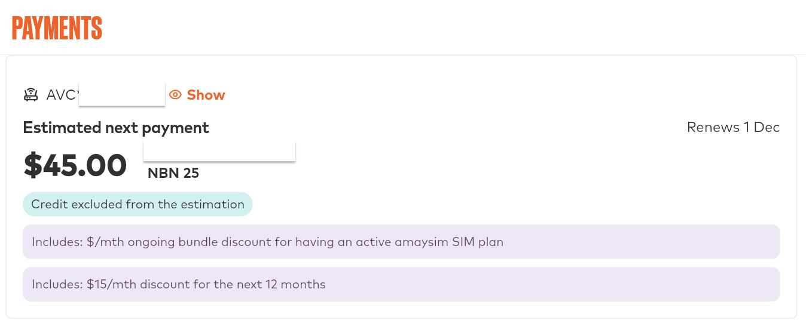

最近，我家的宽带又省了一笔钱，而我做的事情只有一件，就是问了一句客服。

我家的网络，从去年开始就用 [Amaysim](http://r.amaysi.ms/28zdn45x) 的宽带，具体经过写在《[最划算的澳洲宽带？我的60澳元套餐体验](https://www.ozexplorers.com/%E7%BE%8A%E6%AF%9B%E6%94%BB%E7%95%A5/2025/02/07/i-changed-internet-plan-from-belong-to-amaysim.html)》里。

先简单介绍一下我的套餐。我们两个人主要就是看看视频、刷刷手机，所以选的是最基础的 NBN 套餐，下行25Mbps，上行8Mbps。

我家的 NBN 是光纤到路边（FTTC），路由器用的是自己从国内带来的 TP Link。这个套餐原价每月70刀，但是 Amaysim 的手机卡用户可以优惠到每月60刀。我本来就是它的手机卡用户，所以一直是按60刀在付。

用了这么久，我的感受是，对两个人的日常使用来说，这个速度完全够用，我没有觉得比之前的 Belong 差。便宜的价格，加上够用的网速，这就是我一直没有想过再换的原因。

最近我刷手机，看到不少宽带服务商都在推 Black Friday 的活动，于是就去看了Amaysim的网站，上面显示新用户办宽带，可以连续六个月每月减30刀。

看到这个，我的第一反应是，那我这个老客户有没有份？

<!--more-->

于是我去问了客服，有没有针对现有客户的活动。

没想到客服很爽快，直接说可以给我六个月，每月减20刀。我的套餐是60刀，减完就是每月40刀。

我又问，能不能和新用户一样，给我减30刀。客服说不行，那是专门针对新用户的。但是，**他可以换一种方式，十二个月，每月减15刀。**

我算了一下，新用户的优惠是一共180刀。客服给我的方案也是180刀。总额一样，只是摊得更长。

对我来说，第二个方案更好，因为接下来一整年的账单都会稳定下来，不用半年之后再面对一次涨价。

我当然选了后面这个。我也在日历上记了一下到期的时间，十二个月之后，价格会回到60刀，到时候再看看有什么新的活动。

其实这不是第一次了。今年续费手机套餐的时候，客服也主动告诉我，看到去年给了我25%的折扣，今年可以继续给。

去年我提前续费，这次吸取了教训，直接选了自动扣款。去年那次的经历，我写在了《[续费Amaysim手机套餐，我拿到了大折扣](https://www.ozexplorers.com/%E7%BE%8A%E6%AF%9B%E6%94%BB%E7%95%A5/2025/02/15/big-discount-on-renewing-an-amaysim-sim-plan.html)》里。

我从刚到澳洲就一直用 Amaysim 的手机卡，到现在已经好几年了。价格划算，对老客户的优惠也算用心，这是我愿意一直用下去的原因。(使用我的推荐链接[http://r.amaysi.ms/28zdn45x](http://r.amaysi.ms/28zdn45x)，可以获得50澳元的新用户优惠！）

还有一个我很喜欢的地方，是它的境外流量包。比如25刀的那一档，包含2GB流量、50分钟通话和30条短信，很适合短途出国。要提醒的是，这类套餐的内容会调整，出发之前最好先在 App 里确认一下当时的具体内容。

**如果你也想试试问客服，我的经验有三点。**

第一，直接问，有没有针对现有客户的活动，不用绕弯子。

第二，可以把你在官网看到的新客优惠说出来，客服就知道你的参照点在哪里。

第三，如果客服说不能给同样的优惠，不要急着结束对话，问问能不能换一种方式，比如拉长优惠的月数。我这次拿到180刀，就是在第三步。

回头想想，新客优惠本质上是公司的获客成本。老客户已经在了，公司默认你不会走，所以不会主动给你。

但是，如果你开口问，客服手里往往是有预算的。这次我问了一句话，就换来了180刀。

当然，我不能保证每个人问都能拿到。但是问一句不花钱，不问就一定拿不到。
