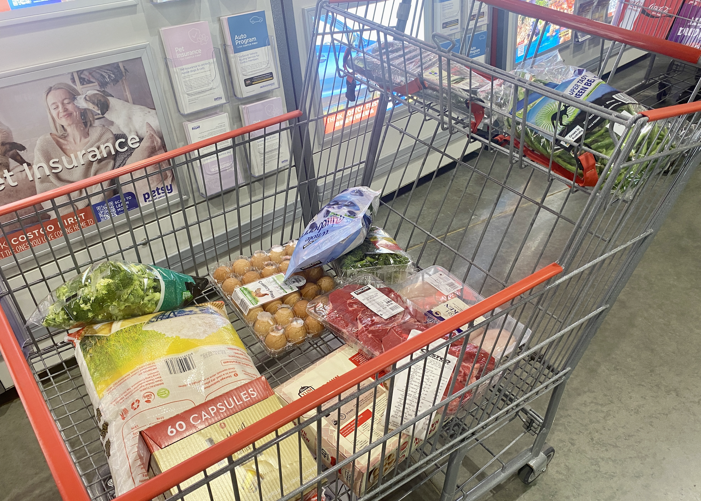
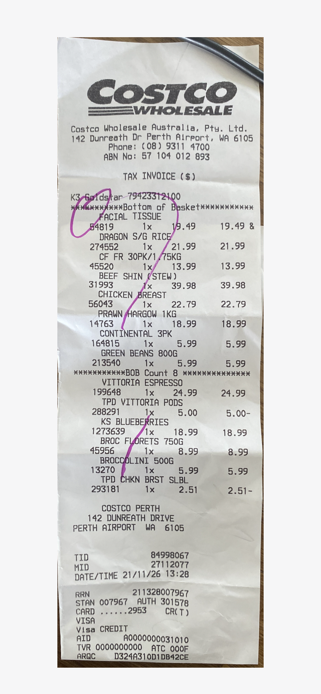

周六中午，我去了一趟Costco，计划先加油，顺便逛一圈超市。

最终，加油花了36.74刀，Costco购物花了200.66刀。

这篇文章，我来分享一下**200澳元在Costco到底能买到多少东西**，让大家直观感受一下澳元的购买力。

<!--more-->

下面的表格是我根据小票整理的，最后一列是我的购买理由。

| 英文                 | 中文                    | 价格     | 购买理由        |
| ------------------ | --------------------- | ------ | ----------- |
| FACIAL TISSUE      | 面巾纸                   | 19.49  | 需要时回购       |
| CF FR 30PK/1.75KG  | 鸡蛋30枚                 | 13.99  | 回购          |
| CHICKEN BREAST     | 鸡胸肉                   | 22.79  | 回购，比Coles便宜 |
| TPD CHKN BRST SLBL | 鸡胸肉折扣                 | -2.51  |             |
| VITTORIA ESPRESSO  | Vittoria Espresso咖啡胶囊 | 24.99  | 回购          |
| TPD VITTORIA PODS  | 咖啡胶囊折扣                | -5.00  |             |
| BEEF SHIN (STEW)   | 牛腱，炖肉用                | 39.98  | 比Coles便宜    |
| DRAGON S/G RICE    | Dragon牌短粒米            | 21.99  | 常买的那款没货，试新的 |
| PRAWN HARGOW 1KG   | 虾饺，1公斤                | 18.99  | 临时起意        |
| KS BLUEBERRIES     | Kirkland蓝莓            | 18.99  | 临时起意        |
| GREEN BEANS 800G   | 四季豆，800克              | 5.99   | 懒得去亚超       |
| BROC FLORETS 750G  | 西兰花小朵，750克            | 8.99   | 懒得去亚超       |
| BROCCOLINI 500G    | 茎西兰花，500克             | 5.99   | 懒得去亚超       |
| CONTINENTAL 3PK    | 黄瓜，3根装                | 5.99   | 懒得去亚超       |
| 合计                 |                       | 200.66 |             |

12样东西原价208.17刀，减掉两笔优惠7.51刀，实付200.66刀。

抽纸、鸡蛋、鸡胸和咖啡胶囊，我一般都是在需要的时候回购。鸡蛋30枚装，折下来约0.47刀一枚。大米是常买的那款没货了，换了这款尝尝。

虾饺和蓝莓是临时起意，看着不错就拿了。蔬菜是懒得再跑一趟亚超，直接在Costco买了大包装，黄瓜3根5.99刀，约2刀一根，价格其实不算贵。

这单里，真正比外面便宜不少的，是**牛腱子、鸡胸和咖啡胶囊**。

牛腱子这包39.98刀，每公斤约19.9刀，这包大概2.01公斤。Coles的牛腱子是每公斤22刀，同样的重量要44.20刀，**省了4.22刀**左右。

鸡胸的标价是每公斤9.99刀，这包大约2.28公斤，标价22.79刀，小票上又减了2.51刀，实付20.28刀，折合每公斤约8.89刀。Coles的鸡胸每公斤11刀，同样的重量要25.09刀，**省了4.81刀**。就算不算那2.51刀的优惠，22.79刀对25.09刀，也省了2.30刀。我最近几次来Costco都买鸡胸，就是因为确实比Coles便宜。

咖啡胶囊实付19.99刀，60颗装，每颗0.33刀左右。[十月那篇](https://www.ozexplorers.com/澳洲生活/2026/10/25/why-i-rarely-buy-coffee-outside.html)写过，外面一杯咖啡五到八刀，在家一颗胶囊三毛多，差了差不多二十倍。

再说说油价。我加的是91号，每升180.7分，加了36.74刀，大约20.33升。我查了FuelWatch当天的数据：珀斯的中位数是197.9分，180.7分是当天全州最低价。跟珀斯的中位数比，这一箱油省了3.50刀左右。

四月，我办了[Costco会员](https://www.ozexplorers.com/羊毛攻略/2026/04/05/is-costco-membership-worth-it.html)，赶上活动，实际支付的年费是45刀。当时我觉得，纸品、日用品这类标准化、耐储存、高频使用的东西，**确实便宜**；生鲜就不一定了，两个人的家庭，最大的挑战是量。

这一趟，牛腱子、鸡胸和油加起来，省了大约12.50刀。按这个数字估算，来四趟左右，45刀的年费就回来了。

半年多过去，我肯定来了不止四次，这张Costco会员卡，**早已值回票价了**。